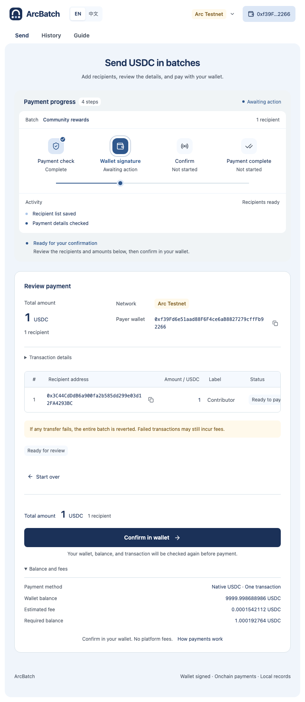

# ArcBatch

Batch USDC payments on Arc.

Import recipients, review payments, and send native USDC to multiple wallets in one transaction. ArcBatch is non-custodial: you connect your wallet and approve each payment yourself. The interface supports English and Simplified Chinese.



The screenshot uses local test accounts and is not evidence of a mainnet payment.

## Features

- Import a CSV, paste a list, or add recipients manually.
- Validate addresses, duplicate recipients, amounts, and the contract's batch limit.
- Connect through Reown AppKit, WalletConnect, or an injected browser wallet.
- Review the total, recipients, network, payer, and estimated fees before signing.
- Verify transaction input and receipt events before marking a batch as paid.
- Recover pending or uncertain payments using their original batch ID.
- Export CSV reports and back up browser-local records as JSON.

One recipient failure reverts the whole batch. Failed transactions may still incur gas fees. There are no platform fees, administrator controls, or contract upgrades. **This project has not received an independent security audit.**

## Quick start

Use the Node.js version in [.nvmrc](.nvmrc). Dependencies and standard Foundry binaries are pinned by `package-lock.json`.

```sh
nvm use
npm ci
cp .env.example .env.local
```

Edit `.env.local` before continuing:

- Replace `VITE_DEPLOYMENT_FILES` with a comma-separated list of filenames from [public/deployments](public/deployments). The first manifest selects the default network; use the testnet manifest first for development.
- Replace `VITE_REOWN_PROJECT_ID` with your public [Reown Project ID](https://dashboard.reown.com), or leave it empty to use injected browser wallets.
- The `ARC_*` entries are only for deployment scripts; they are not required to run the frontend.

```sh
npm run abi
npm run dev
```

Open `http://127.0.0.1:5173`. Recipient preparation works without connecting a wallet. Payments require a valid deployment, an Arc-compatible wallet, and enough native USDC for the payment and gas.

## Deployments

The following manifests record deployment receipts and RPC verification performed on October 13, 2026 or earlier. Addresses are network-specific; the same address on another chain is a different deployment.

| Network     | Contract                                                                                          | Limit          | Manifest                                        |
| ----------- | ------------------------------------------------------------------------------------------------- | -------------- | ----------------------------------------------- |
| Arc Mainnet | [0x083a…9964](https://explorer.arc.io/address/0x083a96f75d6de7e97bd421820c98c25b07b79964)         | 100 recipients | [mainnet.json](public/deployments/mainnet.json) |
| Arc Testnet | [0x6f18…d89a](https://explorer.testnet.arc.io/address/0x6f184941553b2cb886fcc5dd77a2eb3fb979d89a) | 100 recipients | [testnet.json](public/deployments/testnet.json) |

A [legacy testnet manifest](public/deployments/testnet-legacy-2.json) preserves the older two-recipient deployment for historical records. Deployment bytecode verification is distinct from explorer source verification and a security audit. See [deployment details](docs/deployment.md) and [review scope](docs/mainnet-review.md).

The frontend loads each explicitly configured deployment manifest at startup. Its initial network follows the first manifest, and the network selector uses the matching contract for each configured chain. Only one contract per network is accepted; payments remain disabled where no matching deployment is configured. The legacy `VITE_DEPLOYMENT_FILE` setting remains supported when `VITE_DEPLOYMENT_FILES` is absent.

## Build and host

```sh
npm run build
```

The build requires the configured manifest and produces `dist/`. All `VITE_` values are public. Never put private keys, seed phrases, or secret RPC credentials in frontend configuration.

For Vercel, use [vercel.json](vercel.json), configure `VITE_DEPLOYMENT_FILES` and `VITE_REOWN_PROJECT_ID` in the deployment environment, and allow the hosted origin in Reown. The build publishes only the explicitly selected, validated manifests and logo from `public/`. It excludes source maps and local reports. See [hosting instructions](docs/deployment.md#hosting).

## Checks

After configuring `.env.local`:

```sh
npm run check
npm run contracts:coverage
npx playwright install chromium
npm run e2e
```

`check` runs ABI generation, type checks, lint, formatting, frontend coverage, script tests, contract tests, and a production build. Browser tests use local Anvil accounts and run on desktop and mobile Chromium configurations.

[GitHub Actions](.github/workflows/ci.yml) runs these checks on pushes and pull requests using the public testnet manifest. CI needs no signing keys or Reown account. The separate `npm run e2e:appkit` suite requires a valid public Reown Project ID and network access; it is not part of the default workflow. See [testing](docs/testing.md) for scope and optional checks.

## Project layout

| Path                   | Purpose                                                                   |
| ---------------------- | ------------------------------------------------------------------------- |
| `src/`                 | React UI, exact amounts, local records, wallets, and receipt verification |
| `src/generated/abi.ts` | Committed ABI regenerated from the contract source                        |
| `contracts/src/`       | Distributor contract and protocol constants                               |
| `contracts/test/`      | Contract, fuzz, invariant, and adversarial tests                          |
| `tests/` and `e2e/`    | Unit, component, and local EVM browser tests                              |
| `scripts/`             | Build, deployment preparation, verification, and gas measurement          |
| `public/deployments/`  | Public, versioned deployment manifests                                    |
| `docs/`                | Usage, architecture, testing, deployment, and release guidance            |

Generated artifacts, installed dependencies, local environment files, private notes, and payment exports are excluded from Git. `npm run abi` regenerates compiler inputs and synchronizes OpenZeppelin from the pinned npm dependency.

## Documentation

- [User guide](docs/usage.md)
- [Architecture](docs/architecture.md)
- [Testing](docs/testing.md)
- [Deployment and hosting](docs/deployment.md)
- [Contract review](docs/mainnet-review.md)
- [Repository publication](docs/releasing.md)
- [Contributing](CONTRIBUTING.md)
- [Security](SECURITY.md)

## License

[MIT](LICENSE) © 2026 ArcBatch contributors. Third-party dependencies retain their own licenses, including OpenZeppelin's MIT license.
