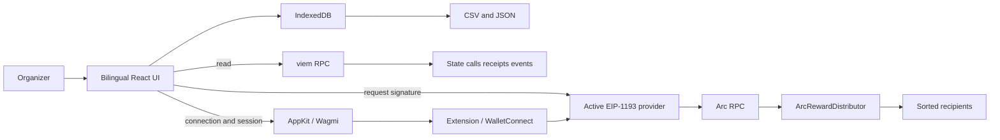
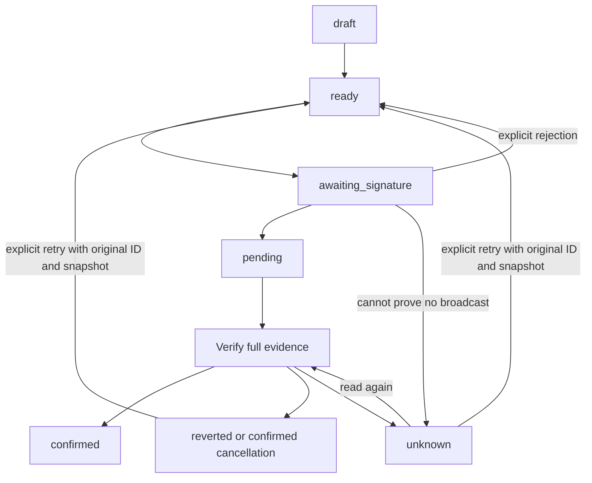
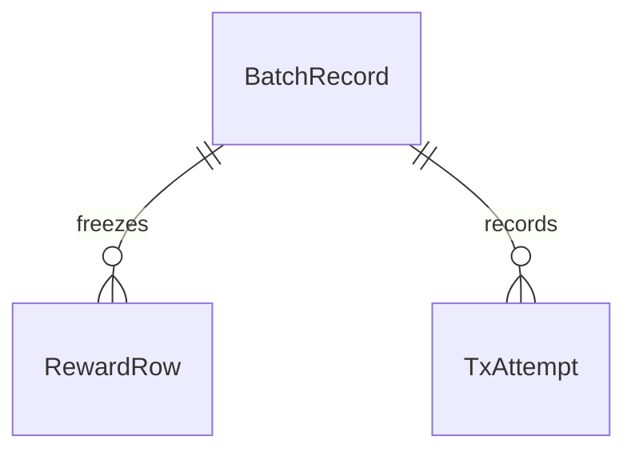

# Scope and architecture

Version one distributes native Arc USDC atomically in one transaction per batch. Organizers determine eligibility and amounts. There is no automatic splitting, multi-token support, administrator service, custodial wallet, or cross-device backend.

## System

```text
[Organizer] --> [Bilingual React UI] --> [IndexedDB drafts / batches / attempts]
                         |                                |
                         |                                +--> [CSV / JSON]
                         +-- read --> [viem RPC] --> [State / calls / receipts / events]
                         +-- connect --> [AppKit / Wagmi] --> [Extension / WalletConnect]
                         +-- sign --> [Active EIP-1193 provider] --> [Arc RPC]
                                                                         |
                                                                         v
                                                               [ArcRewardDistributor]
                                                                         |
                                                                         v
                                                                [Sorted recipients]
```



## Wallet connection

`src/reown.ts` initializes AppKit and WagmiAdapter with a public project ID, centralized networks/RPCs, and the application's theme. Wallet discovery and WalletConnect use Reown services. Balances, preflight, and evidence use the configured Arc RPC.

`ReownWallet` adapts the active connector to the payment interface. Provider retrieval and submission verify connector, account, and chain consistency. Account subscriptions immediately invalidate preflight; stale asynchronous reads cannot overwrite a new account or disconnection. Missing configuration or initialization failure falls back to injected wallets with an explanatory notice.

## Amounts and preflight

Ordinary decimal strings become 18-decimal native `bigint` values. Reward input is limited to six decimal places; balances and fees retain native precision. Addresses accept lowercase, uppercase, or valid checksum forms. Sorting uses lossless `uint160` values and moves amounts with addresses.

The contract validates the entire list, marks `executed`, then performs checked native `call` transfers. OpenZeppelin's persistent-storage `ReentrancyGuard` avoids dependence on transient storage. A failed transfer rolls back earlier balance changes, events, and the executed flag.

Preflight checks wallet context, RPC chain ID, contract code hash, version, maximum recipients, and executed state. It simulates exact calldata/value, then obtains gas, EIP-1559 fees, and balance from RPC. The centralized gas margin rounds upward. Required balance is reward total plus `gasLimit × maxFeePerGas`. Submission repeats preflight; an earlier simulation is not an execution guarantee.

## State transitions

```text
[draft] --> [ready] --> [awaiting_signature] --> [pending]
                ^                |                 |
                |          explicit rejection      v
                +----------------+            [verify evidence]
                                                    |
                         +--------------------------+--------------------+
                         v                          v                    v
                    [confirmed]           [reverted / cancelled]     [unknown]
                                                                     |
                                                                     +--> read again
[unknown / reverted / cancelled] -- explicit retry, same ID and snapshot --> [ready]
```



Cancellation requires a confirmed cancellation/replacement receipt and executed-state checks. An unconfirmed replacement remains unknown. An old reverted attempt cannot override a newer uncertain attempt. Submitted batches continue querying the frozen network after account changes.

## Local model

```text
[BatchRecord] -- 1:N --> [RewardRow frozen execution list]
      |
      +-------- 1:N --> [TxAttempt and replacements]
      |
      +-------- verify --> [Actual call / receipt / per-recipient events]
```



The snapshot contains payer, chain, contract, original ID, canonical recipients, payload hash, and total. Storage keys combine chain, contract, payer, and batch ID. Amounts, gas, and blocks persist as decimal strings; chain IDs, nonces, and row indices use validated safe integers.

After preflight, one IndexedDB read/write transaction checks current status, saves the full attempt and preflight block, and claims the batch. A slow tab cannot restore another tab's in-flight batch to ready. Browser locks reduce concurrent signature prompts; BroadcastChannel refreshes other tabs. The contract is the final replay protection. Storage failure blocks a new payment.

Backup import checks schema, size, addresses, precision, ordering, and digest. Imported success labels and receipts are discarded as trusted evidence; records become unknown. Conflicting snapshots under one key cannot overwrite each other. Schema version 1 rejects unknown versions explicitly; future migrations must be versioned.

## Localization

English is the default. Both `en` and `zh-CN` preferences persist. Stable Chinese keys and legacy error patterns feed the English catalog. Only application messages and report status labels are translated. Activity names, labels, wallet names, calldata, hashes, numeric strings, stored snapshots, and JSON backups remain unchanged. Language changes do not reconnect wallets or resubmit transactions.

## Evidence boundaries

Verification parses only distributor events, excluding Arc system and ERC-20 transfer emitters. The actual calldata, value, payer, target, and chain must match the snapshot. Exactly one `BatchPaid` and the complete indexed `RewardPaid` set must match the digest, count, total, recipient addresses, and amounts.

Log recovery starts at a known deployment or preflight block and uses bounded RPC windows. Missing start points or incomplete evidence never imply success. Local labels and imported files cannot substitute for onchain verification.
